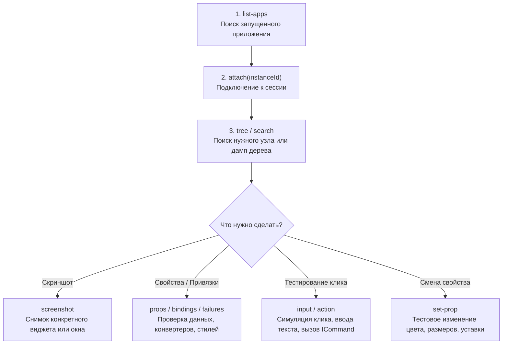

# XamlMcp Skill: Live Avalonia UI Inspection & Automation

Инструкция и регламент работы с **XamlMcp** ([github.com/trrahul/XamlMcp](https://github.com/trrahul/XamlMcp)) — специализированным MCP-сервером и инструментом инспекции реального времени для приложений на **Avalonia UI**, WPF и WinUI.

---

## 💡 Обзор архитектуры

XamlMcp состоит из двух ключевых компонентов:
1. **`XamlMcp.Avalonia` (In-process агент)**: Легковесная библиотека внутри приложения Avalonia, открывающая именованный пайп (`named pipe`) для отладочного взаимодействия. В релизных сборках отключается или полностью исключается через `#if DEBUG`.
2. **`XamlMcp.Server` (Stdio MCP сервер)**: Процесс-мост, транслирующий команды LLM/агента (JSON-RPC MCP) в запросы к запущенному приложению через локальный защищенный канал.

---

## 🛠️ 1. Подключение агента к проекту Avalonia

### А. Установка NuGet-пакета
В проект `AvaloniaApplication1/AvaloniaApplication1.csproj`:
```bash
dotnet add AvaloniaApplication1/AvaloniaApplication1.csproj package XamlMcp.Avalonia --version 1.0.0-preview.3
```

### Б. Инициализация в коде (Рекомендуемый шаблон)
В `AvaloniaApplication1/Program.cs`:
```csharp
using Avalonia;
using XamlMcp.Avalonia;

namespace AvaloniaApplication1;

internal sealed class Program
{
    public static void Main(string[] args) => BuildAvaloniaApp()
        .StartWithClassicDesktopLifetime(args);

    public static AppBuilder BuildAvaloniaApp()
    {
        var builder = AppBuilder.Configure<App>()
            .UsePlatformDetect()
            .WithDeveloperTools();

#if DEBUG
        // Агент компилируется только в Debug-режиме
        builder.AttachXamlMcp();
#endif

        return builder;
    }
}
```

> **Важно**: При вызове через `builder.AttachXamlMcp()` агент активен только при наличии переменной окружения `XAML_MCP=1`:
> ```powershell
> $env:XAML_MCP=1; dotnet run --project AvaloniaApplication1/AvaloniaApplication1.csproj
> ```

---

## ⚙️ 2. Настройка MCP-сервера в Antigravity

В глобальный файл конфигурации MCP `C:\Users\erch\.gemini\config\mcp_config.json` добавляется секция `xamlmcp`:

```json
{
  "mcpServers": {
    "xamlmcp": {
      "command": "dotnet",
      "args": [
        "C:\\Users\\erch\\.gemini\\tools\\xamlmcp\\XamlMcp.Server.dll"
      ]
    }
  }
}
```

*Для запуска сервера требуется установленный .NET 10 Runtime (`winget install Microsoft.DotNet.Runtime.10`).*

---

## 🚀 3. Пошаговый рабочий процесс (Agent Workflow)

Когда приложение запущено с `$env:XAML_MCP=1`, агент выполняет следующие шаги:



### Шаг 1: Обнаружение приложения
Вызовите инструмент `list-apps`:
* Возвращает список запущенных приложений с `instanceId`, `pid`, названием окна и фреймворком (`Avalonia`).

### Шаг 2: Подключение
Вызовите `attach` с параметром `instanceId`:
```json
{
  "instanceId": "<id из list-apps>"
}
```
* Возвращает список поддерживаемых возможностей (capabilities).

### Шаг 3: Поиск элементов интерфейса
Поиск конкретного виджета или кнопки по имени, типу или классу стиля:
```json
// Поиск по имени x:Name
{ "name": "ValvesContainer" }

// Поиск по типу контрола
{ "type": "ValveControl" }

// Поиск по подписи/тексту кнопки
{ "text": "ПУСК" }
```

### Шаг 4: Снимок экрана (Визуальная инспекция)
Захват изображения окна или конкретного виджета без сторонних утилит:
```json
{
  "target": { "name": "MainDashboardView" }
}
```
* Возвращает изображение PNG напрямую в контекст агента для визуальной проверки верстки, шрифтов и контраста.

### Шаг 5: Проверка ошибок и привязок данных (Bindings Diagnostics)
Диагностика сбоев в `Binding`, проблем с `DataContext` или ошибок конвертеров:
```json
{
  "target": { "type": "ValueDisplay" }
}
```
* Показывает путь биндинга, текущее значение источника и текст ошибки XAMLIL/BindingException.

### Шаг 6: Взаимодействие (Интерактивные действия)
* **Клик по кнопке**: инструмент `action` с `pattern: "invoke"` или `input` с `action: "click"`.
* **Изменение свойства на лету**: инструмент `set-prop` (`name: "IsActive"`, `value: true`).

---

## 📋 4. Основные инструменты XamlMcp (Cheatsheet)

| Инструмент | Описание | Типичные аргументы |
|---|---|---|
| `list-apps` | Список активных запущенных приложений | *без параметров* |
| `attach` | Подключение к приложению | `{"instanceId": "..."}` |
| `detach` | Отключение от приложения | *без параметров* |
| `tree` | Дамп визуального/логического дерева | `{"depth": 5, "profile": "semantic"}` |
| `search` | Поиск элементов по фильтрам | `{"name": "...", "type": "Button", "text": "..."}` |
| `props` | Чтение свойств элемента | `{"target": {"name": "Pump1"}}` |
| `set-prop` | Изменение значения свойства | `{"target": {"name": "Pump1"}, "name": "IsRunning", "value": true}` |
| `bindings` | Инспекция привязок и DataContext | `{"target": {"name": "Valve1"}}` |
| `failures` | Список ошибок биндингов/диспетчера | `{"categories": ["binding", "dispatcher"]}` |
| `screenshot` | Снимок окна или отдельного узла | `{"target": {"name": "MainWindow"}}` |
| `input` | Мышь и клавиатура | `{"target": {"name": "BtnStart"}, "type": "click"}` |
| `action` | Вызов команд (`ICommand`, `Invoke`) | `{"target": {"name": "BtnStart"}, "pattern": "invoke"}` |
| `pseudo-class`| Включение псевдоклассов Avalonia | `{"target": {"name": "Btn"}, "name": ":pointerover", "value": true}` |

---

## 🛡️ Безопасность и правила использования в проекте

1. **Изоляция Release-сборок**: Вызов `.AttachXamlMcp()` всегда должен быть обернут в `#if DEBUG`, чтобы агент никогда не попадал в боевые промышленные бинарники.
2. **Нулевые аллокации**: Инспекция через XamlMcp не должна вызывать утечек памяти в цикле `Render` Avalonia.
3. **Безопасность Named Pipe**: XamlMcp использует авторизованный локальный именованный канал Windows только в пределах текущего пользователя (`current-user ACL`).
