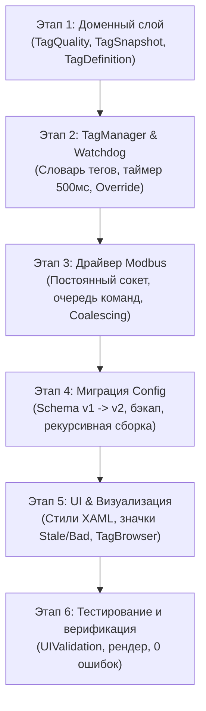

# Переход на промышленную архитектуру TagManager (по стандартам Rapid SCADA v6)

* **Автор:** Senior C# / .NET / Avalonia UI Architect
* **Дата:** 2026-11-03

## Обзор (Overview)

Настоящий документ определяет архитектурную модернизацию проекта `AvaloniaApplication1` (промышленный HMI/SCADA-клиент на .NET 8, Avalonia UI 12, CommunityToolkit.Mvvm) на основе ядра **Rapid SCADA v6** (`ScadaCommon`, `ScadaData`, `ScadaComm`).

Основная цель — замена жесткой привязки UI-виджетов к физическим адресам на первый класс **промышленного слоя тегов (Tag Engine)**. Архитектура внедряет флаги достоверности OPC-уровня (`TagQuality`), сторожевой таймер зависания данных (Watchdog), пакетный опрос Modbus (Coalescing / PDU Split), единый постоянный сокет с очередью команд и ручным переопределением (Override), а также однократную миграцию файлов `config.json` (v1 → v2) при сохранении 100% нативного Desktop-стека.

---

## Анализ (Analysis)

Комплексный аудит шестью рецензентами Goldfish выявил ключевые архитектурные вызовы и решения:

### 1. Архитектурный дефект сокетов в `ModbusProtocolDriver` (Критический блокер)
* **Проблема:** В текущем коде `ModbusProtocolDriver.cs` метод `WriteAsync` создает `new TcpClient()` и выполняет повторное подключение на **каждую запись команды**, в то время как фоновый цикл `PollModbusLoop` непрерывно удерживает активный сокет к тому же IP:порту. Промышленные контроллеры (Siemens, Schneider, ОВЕН) сбрасывают или отклоняют параллельные сокеты на порту 502.
* **Решение:** Единый постоянный сокет на линию связи, синхронизированный через `Channel<ModbusCommandRequest>`. Очередь записи имеет абсолютный приоритет над циклом опроса.

### 2. Устранение риска «невидимого зависания» (Silent Freeze)
* **Проблема:** Если контроллер завис или сетевой кабель оборван, виджеты продолжают отображать последнее значение. В опасных технологических процессах (нагрев реактора R-101) это ведет к авариям.
* **Решение:** Введение `TagSnapshot` со статусом `TagQuality` (`Good`, `Bad`, `Stale`, `CommFailure`, `Overridden`) и централизованного Watchdog-таймера (интервал проверки 500 мс). Если тег не обновляется дольше допустимого времени, статус переходит в `Stale/Timeout`.

### 3. Оптимизация опроса Modbus (Coalescing & PDU Split)
* **Проблема:** Опрос $N$ тегов отдельными запросами перегружает шину и увеличивает время цикла опроса в десятки раз.
* **Решение:** Алгоритм сортировки тегов по кодам функций и адресам, группировка соседних регистров с зазором `MaxGap <= 5` в единые bulk-кадры `ReadHoldingRegisters`, и автоматическое разбиение блоков при превышении лимита 120 регистров.

### 4. Человеко-машинный интерфейс (High-Performance HMI / ISA-101)
* **Решение:** Нормальное состояние (`Good`) визуально чистое и контрастное. При `Stale` виджет тускнеет (55% Opacity), значение окаймляется штриховой рамкой, появляется глиф `⏳`. При `Bad/CommFailure` значение перечеркивается (`---`), а в тултипе отображается диагностика связи. Принудительно заданные оператором значения (`Overridden`) помечаются маджентовым маркером `[M]`, чтобы исключить путаницу с реальными сигналами датчиков.

### 5. Однократная миграция конфигурации (Schema v1 → v2)
* **Решение:** При загрузке `config.json` сервис `ConfigMigrationService` проверяет версию схемы:
  1. Создает резервную копию `config.v1.backup.json`.
  2. Рекурсивно извлекает встроенные пары `(connId, address)` из дашбордов, мнемосхем и контейнеров `ContainerButton.Children`.
  3. Формирует централизованную таблицу `Tags: [ ... ]` с уникальными `TagId`.
  4. Перепривязывает виджеты на ссылки `TagId` и сохраняет `config.json` с `"SchemaVersion": 2`.
  5. Для необработанных или динамических виджетов предусмотрен фолбэк с автосинтезом виртуального тега на лету.

---

## Границы проекта (Goals vs. Non-Goals)

### Что входит в скоуп (In-Scope Goals)

* **Доменные модели:** `TagQuality : byte`, `readonly record struct TagSnapshot`, класс `TagDefinition`.
* **Сервисный слой:** `TagManagerService` со сторожевым таймером устаревания (Watchdog) и поддержкой ручного переопределения (Force/Override).
* **Сетевой уровень:** Рефакторинг `ModbusProtocolDriver` на единый сокет, приоритетную очередь команд записи и алгоритм батчинга регистров с нарезкой по 120 регистров.
* **Миграция:** Модуль автоматического однократного обновления схемы `config.json` с созданием резервной копии.
* **Интерфейс:** Поддержка состояний качества в `WidgetViewModelBase`, стилизация XAML (`DashboardView.axaml`), диалог выбора тегов (`TagBrowserDialog`) в редакторе виджетов.

### Что исключено из скоупа (Out-of-Scope Non-Goals)

* **WebAssembly (WASM):** Полностью исключен. Архитектура фиксируется как 100% нативный Desktop (.NET 8 Windows/Linux/macOS) с прямым доступом к сокетам TCP/IP и COM-портам.
* **Внешняя СУБД конфигурации:** Никаких баз данных PostgreSQL/SQLite или внешних процессов демонов; всё конфигурируется через компактный структурированный `config.json`.
* **Сторонние тяжелые фреймворки:** Отказ от `DynamicData` в пользу легковесных `ConcurrentDictionary` и нативных потоков Rx.NET для минимизации нагрузки на сборщик мусора.

---

## Рассмотренные альтернативы (Alternatives Weighed)

1. **Сохранение прямого маппинга виджетов с добавлением флагов качества:**
   * *Отклонено:* Сохраняет спагетти-связи. Сдвиг адресов в контроллере требует ручного редактирования каждого виджета.
2. **Поддержка WebAssembly через шлюз WebSockets / SignalR:**
   * *Отклонено:* Пользователь подтвердил отказ от WASM. Введение дополнительного шлюзового сервера неоправданно усложняет эксплуатацию локальной SCADA на промышленных ПК.
3. **Безусловная жесткая блокировка кнопок при плохом качестве связи:**
   * *Отклонено:* В реальной наладке оператор обязан иметь возможность принудительной отправки команды управления в обход ограничений (с подтверждением предупреждения).

---

## План этапов реализации (Staging)

