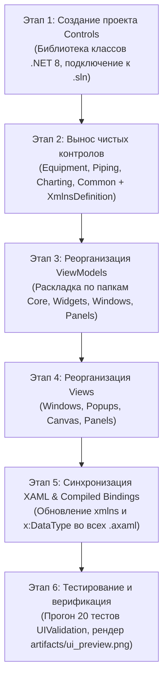

# Архитектурный бриф: Вынос библиотеки SCADA-контролов и иерархическая реорганизация проекта

* **Автор:** Senior C# / .NET / Avalonia UI Architect
* **Дата:** 2026-11-14
* **Статус:** Синтез рецензий Goldfish завершен (6/6 линз активны)

---

## 1. Обзор (Overview)

Настоящий документ определяет архитектурный план трансформации монолитной структуры `AvaloniaApplication1` в модульный промышленный фреймворк:
1. Вынос всех специализированных векторных SCADA-аппаратов и графических компонентов в отдельную переиспользуемую библиотеку классов **`AvaloniaApplication1.Controls`** (.NET 8 / Avalonia 12.0.4).
2. Полная иерархическая реорганизация директорий `Views/` и `ViewModels/` со строгим переименованием пространств имен C# под каждую папку (`Equipment`, `Windows`, `Widgets`, `Panels`, `Core`).
3. Внедрение унифицированного XAML пространства имен через `[assembly: XmlnsDefinition]` для чистого синтаксиса `<scada:ValveControl>` вместо разрозненных `clr-namespace`.
4. Сохранение 100% работоспособности скомпилированных привязок (Compiled Bindings) и успешного прохождения всех 20 этапов автоматических тестов `AvaloniaApplication1.UIValidation`.

---

## 2. Анализ и архитектурный аудит (Multi-Lens Findings)

### 🔴 Критический блокер: Циклическая зависимость холста (`DashboardPanel`)
* **Проблема:** В текущем коде `DashboardPanel.cs` и `PipeControl.cs` напрямую обращаются к вьюмоделям основного приложения:
  * `DashboardPanel.cs` вызывает методы и свойства `WidgetViewModelBase` (`_dragVm`, `_selectedVm`), `PipeWidgetViewModel` (`NormalizePointsAndSize()`) и `DashboardViewModel` (`GetDashboardViewModel()`, `CopyWidgetCommand`, `PasteWidgetCommand`).
  * `PipeControl.cs` содержит приведение `DataContext as PipeWidgetViewModel` (строки 486–488).
* **Следствие:** Если переместить `DashboardPanel` в новую библиотеку `AvaloniaApplication1.Controls`, библиотека не сможет скомпилироваться без ссылки на `AvaloniaApplication1`, что порождает циклическую зависимость проектов (`Controls <--> App`).
* **Решение:**
  * **Вариант А (Каноническая изоляция контролов):** В отдельную библиотеку `AvaloniaApplication1.Controls.csproj` выносятся **только чистые визуальные контролы** оборудования (`ValveControl`, `PipeControl`, `ReactorControl`, `HeatExchangerControl`, `LevelSensorControl`, `TrendLineControl`, `ColorPickerBox`, `FormatEditorBox`), а из `PipeControl` удаляется прямое приведение к VM (биндинг точек переводится на `PointsProperty`). Интерактивный редакторский холст `DashboardPanel` с оверлеями перемещается в `AvaloniaApplication1/Views/Canvas/`.
  * **Вариант Б (Полная развязка через события и присоединенные свойства):** `DashboardPanel` очищается от любых упоминаний ViewModel. Команды копирования/вставки делегируются через стандартные Routed Events / KeyBindings родительского `DashboardView`.

### 🟡 Скомпилированные привязки и XAMLIL (`x:DataType` / AVLN2000)
* В `DashboardView.axaml` объявлено более 15 блоков `<DataTemplate DataType="{x:Type vm:XyzViewModel}">`.
* При переносе вьюмоделей в `ViewModels/Widgets/` все директивы типов должны быть обновлены на `x:DataType="vmWidgets:..."`, а стиль контейнера — на `x:DataType="vmCore:WidgetViewModelBase"`. Любая пропущенная строчка вызовет фатальную ошибку компилятора XAMLIL.

### 🟢 Единый XMLNS для XAML (Developer Ergonomics)
* Чтобы в XAML не подключать 5 разных `clr-namespace`, в `AvaloniaApplication1.Controls/Properties/AssemblyInfo.cs` регистрируется сквозной XMLNS:
  ```csharp
  [assembly: XmlnsDefinition("https://github.com/avaloniaapplication1/controls", "AvaloniaApplication1.Controls.Equipment")]
  [assembly: XmlnsDefinition("https://github.com/avaloniaapplication1/controls", "AvaloniaApplication1.Controls.Piping")]
  [assembly: XmlnsDefinition("https://github.com/avaloniaapplication1/controls", "AvaloniaApplication1.Controls.Charting")]
  [assembly: XmlnsDefinition("https://github.com/avaloniaapplication1/controls", "AvaloniaApplication1.Controls.Common")]
  ```
* Это дает возможность использовать в любом окне единый компактный префикс:
  ```xml
  xmlns:scada="https://github.com/avaloniaapplication1/controls"
  ...
  <scada:ValveControl ... />
  <scada:PipeControl ... />
  <scada:ReactorControl ... />
  ```

---

## 3. Целевая топология структуры решения

```
AvaloniaApplication1.sln
│
├── AvaloniaApplication1.Controls/               <-- НОВЫЙ ПРОЕКТ (Class Library, .NET 8)
│   ├── Properties/AssemblyInfo.cs               <-- [XmlnsDefinition]
│   ├── Equipment/                               <-- Namespace: AvaloniaApplication1.Controls.Equipment
│   │   ├── ValveControl.cs
│   │   ├── ReactorControl.cs
│   │   ├── HeatExchangerControl.cs
│   │   └── LevelSensorControl.cs
│   ├── Piping/                                  <-- Namespace: AvaloniaApplication1.Controls.Piping
│   │   └── PipeControl.cs
│   ├── Charting/                                <-- Namespace: AvaloniaApplication1.Controls.Charting
│   │   └── TrendLineControl.cs
│   └── Common/                                  <-- Namespace: AvaloniaApplication1.Controls.Common
│       ├── ColorPickerBox.axaml/.cs
│       └── FormatEditorBox.axaml/.cs
│
├── AvaloniaApplication1/                        <-- ОСНОВНОЕ ПРИЛОЖЕНИЕ (WPF/Desktop Host)
│   ├── Views/
│   │   ├── Canvas/                              <-- Холст мнемосхемы и оверлеи
│   │   │   ├── DashboardPanel.cs
│   │   │   ├── Helpers/ (VisualPortHelper.cs, GridMathHelper.cs)
│   │   │   └── Overlays/ (SelectionOverlay.cs, GridOverlay.cs)
│   │   ├── Windows/                             <-- Окна и диалоги
│   │   │   ├── MainWindow.axaml/.cs
│   │   │   ├── WidgetEditorWindow.axaml/.cs
│   │   │   ├── DashboardPropertiesWindow.axaml/.cs
│   │   │   ├── ConnectionManagerWindow.axaml/.cs
│   │   │   ├── ConnectionEditorWindow.axaml/.cs
│   │   │   ├── SettingsWindow.axaml/.cs
│   │   │   ├── PasswordPromptWindow.axaml/.cs
│   │   │   ├── ConfirmPromptWindow.axaml/.cs
│   │   │   └── Tags/ (TagManagerWindow, TagEditWindow, TagForceWindow, TagPickerWindow, TagImportExportWindow)
│   │   ├── Popups/                              <-- MDI-пульты и калькуляторы
│   │   │   ├── ValveControlPopupView.axaml/.cs
│   │   │   ├── CalculatorView.axaml/.cs
│   │   │   └── NumpadView.axaml/.cs
│   │   └── Panels/                              <-- Основной контейнер экрана
│   │       └── DashboardView.axaml/.cs
│   │
│   └── ViewModels/
│       ├── Core/                                <-- Базовые сущности MVVM
│       │   ├── ViewModelBase.cs
│       │   ├── WidgetViewModelBase.cs
│       │   ├── ChildWindowViewModel.cs
│       │   └── IWidgetFactory.cs
│       ├── Windows/                             <-- Вьюмодели окон
│       │   ├── MainViewModel.cs
│       │   ├── WidgetEditorViewModel.cs
│       │   ├── SettingsViewModel.cs
│       │   ├── ConnectionManagerViewModel.cs
│       │   ├── ConnectionEditorViewModel.cs
│       │   └── Tags/ (TagManagerViewModel, TagEditViewModel, etc.)
│       ├── Panels/
│       │   └── DashboardViewModel.cs
│       └── Widgets/                             <-- Вьюмодели технологических аппаратов
│           ├── WidgetFactory.cs
│           ├── ValveWidgetViewModel.cs
│           ├── PumpWidgetViewModel.cs
│           ├── PipeWidgetViewModel.cs
│           ├── ReactorWidgetViewModel.cs
│           ├── HeatExchangerWidgetViewModel.cs
│           ├── LevelSensorWidgetViewModel.cs
│           ├── TankWidgetViewModel.cs
│           ├── ValueDisplayViewModel.cs
│           ├── CommandButtonViewModel.cs
│           ├── SetValueViewModel.cs
│           ├── RealTimeTrendViewModel.cs
│           └── ContainerButtonViewModel.cs
│
└── AvaloniaApplication1.UIValidation/           <-- ТЕСТОВЫЙ РАННЕР (20/20 тестов)
```

---

## 4. Поэтапный план реализации (Staging Runbook)



---

## 5. Границы скоупа (Goals vs Non-Goals)

### Входит в скоуп:
* Создание отдельного проекта `AvaloniaApplication1.Controls.csproj` и добавление ссылки в приложение и тесты.
* Физическое перемещение файлов и строгое переименование C#-пространств имен под каждую директорию.
* Регистрация `[XmlnsDefinition]` для лаконичного подключения в разметке.
* Полное обновление `x:DataType` и `xmlns` без нарушения скомпилированных привязок.
* Сохранение 100% работоспособности всех 20 тестов в `UIValidation`.

### Исключено из скоупа:
* Изменение логики рендеринга аппаратов (Zero-Allocation перья и вызовы `AffectsRender` остаются неизменными).
* Изменение протоколов связи (Modbus/MQTT) или логики TagManager.
* Упаковка в NuGet-пакет (на текущем этапе проект подключается как проектная ссылка в репозитории).
