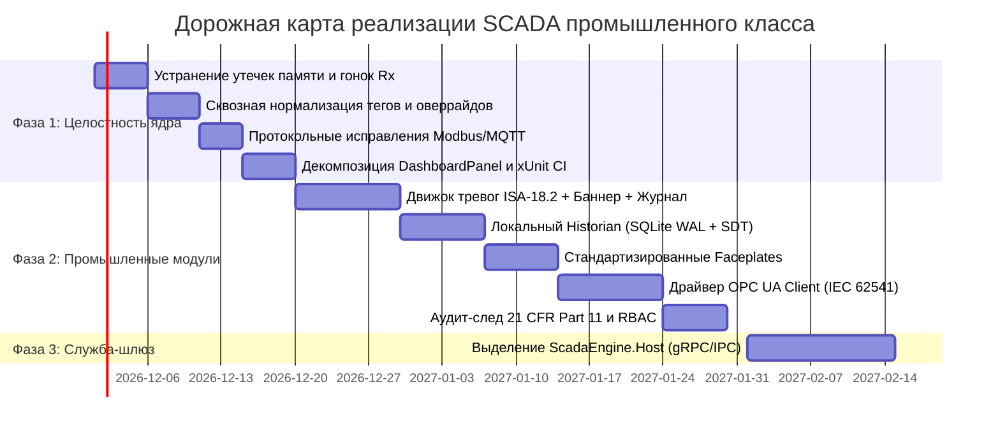

# 🏭 Глубокий аудит и план эволюции HMI/SCADA до индустриальных стандартов (EGM Audit & Industrial Evolution Plan)

> **Статус:** Одобрен к реализации (EGM Synthesized)  
> **Дата:** 24 ноября 2026 г.  
> **Проект:** `AvaloniaApplication1` (Avalonia UI 12.0.4, .NET 8, C# 12)  
> **Экспертные панели:** EGM Design Critic (Анализ уязвимостей и пробелов), EGM TRIZ Catalyst (Разрешение противоречий), EGM Tech Lead (План реализации)

---

## 📌 1. Вводное резюме и текущий базис (Baseline)

Текущий проект `AvaloniaApplication1` представляет собой высокопроизводительный прототип графического HMI/SCADA-редактора и мнемосхемы с развитыми возможностями:
- **Разделение слоев:** Чистая архитектура (`Domain → Application → Presentation → Infrastructure`).
- **Специализированная библиотека контролов:** `AvaloniaApplication1.Controls` (`ValveControl`, `PipeControl`, `TrendLineControl`, `ReactorControl`, `PumpControl`, `HeatExchangerControl`, `LevelSensorControl`) с нулевыми аллокациями в `Render(DrawingContext)` на летучих циклах.
- **Интерактивные редакторы:** CAD-система манипуляции виджетами, автотрассировка и авторазделение трубопроводов с клапанами, прилипание (Smart Guides), резиновая рамка выделения.
- **Подсистемы:** Движок истории Undo/Redo и Time-Travel с боковой панелью, динамические темы Dark/Light, промышленный многоперьевой тренд `RealTimeTrend` с кольцевым буфером `RingBuffer<T>`, полноэкранный `TagManagerWindow` и адаптивный `TagPickerWindow` с поиском, фильтрацией и сортировкой.
- **Протоколы:** Modbus TCP/RTU с объединением смежных регистров (PDU coalescing до 120 слов) и выделенным каналом приоритетных записей; базовый MQTT; локальный симулятор `ModbusServerManager` и `SimulationEngine`.
- **Испытательный стенд:** Headless-тесты Tier 1 (`AvaloniaApplication1.UIValidation`) — **27 из 27 тестов проходят успешно (0 ошибок, 0 предупреждений)**.

Однако при сопоставлении с флагманскими промышленными SCADA-системами (**Siemens WinCC / WinCC OA, Inductive Automation Ignition, AVEVA/Wonderware InTouch, COPA-DATA zenon, Emerson DeltaV**) и стандартами **ISA-18.2** (управление тревогами), **ISA-101** (высокоэффективный HMI), **IEC 62541** (OPC UA), **IEC 62443 / 21 CFR Part 11** (кибербезопасность и аудит-след) выявлены фундаментальные архитектурные риски и отсутствующие компоненты.

---

## 🔍 2. Выявленные архитектурные уязвимости (Hostile Audit)

### 2.1. Шина данных и целостность телеметрии (Data Bus & Telemetry Integrity)
1. **Гонки потоков в `Subject<T>` (Нарушение грамматики Rx):**
   - В [DataCoreService.cs](file:///c:/Users/adm/projects/AvaloniaApplication1/AvaloniaApplication1/Services/DataCoreService.cs) (`_unifiedTagStream`) и [TagManagerService.cs](file:///c:/Users/adm/projects/AvaloniaApplication1/AvaloniaApplication1/Services/TagManagerService.cs) (`_snapshotSubject`) вызовы `OnNext` производятся параллельно из сетевых потоков `ModbusProtocolDriver`, `MqttProtocolDriver`, сторожевого таймера `CheckStaleTags` и пользовательских команд без синхронизации (`Subject.Synchronize`). Это создает риск повреждения внутренних списков подписчиков Rx и потери сообщений.
2. **Обход масштабирования (`ScaleA/B`), зоны нечувствительности (`Deadband`) и ручных переопределений (`ForceOverride`):**
   - В [WidgetViewModelBase.cs](file:///c:/Users/adm/projects/AvaloniaApplication1/AvaloniaApplication1/ViewModels/Core/WidgetViewModelBase.cs) и конкретных VM оборудования ([ValveWidgetViewModel.cs](file:///c:/Users/adm/projects/AvaloniaApplication1/AvaloniaApplication1/ViewModels/Widgets/ValveWidgetViewModel.cs), [PumpWidgetViewModel.cs](file:///c:/Users/adm/projects/AvaloniaApplication1/ViewModels/Widgets/PumpWidgetViewModel.cs), `LevelSensorWidgetViewModel`, `ReactorWidgetViewModel`) метод `OnTagValueUpdated(object newValue)` игнорирует аргумент `newValue` и обращается напрямую к `DataService.GetCurrentValue(Source.ConnId, Source.Address)`.
   - В свою очередь, `DataCoreService.PublishTag` записывает в кэш `_currentValuesCache` **сырые несмасштабированные** данные *до* того, как `TagManagerService` применит калибровку, фильтр зоны нечувствительности или ручной форсированный оверрайд. В результате контролы оборудования работают в обход словаря тегов.
3. **Оптимистичные записи без подтверждения (Blind Optimistic Writes):**
   - Метод `DataCoreService.WriteCommand` немедленно вызывает `PublishTag(...)`, визуально изменяя состояние кнопки или задвижки на мнемосхеме еще до отправки команды в сеть, после чего асинхронно запускает `WriteAsync` в режиме `FireAndForget`. В случае обрыва связи, отказа ПЛК или сбоя драйвера интерфейс показывает ложное состояние оборудования без какого-либо оповещения оператора.
4. **Пропуск перьев тренда при сканировании тегов (`ExtractAllTags`):**
   - Метод `DataCoreService.ExtractAllTags` сканирует неактуальные `BridgeRules`, но **не сканирует массив `RealTimeTrendConfig.Pens[*].Source`**. Если тег пера не прописан явно в общем списке `config.Tags`, он не будет опрашиваться драйвером.
5. **Утечка состояния при перезагрузке проекта:**
   - При открытии нового файла проекта `DataCoreService.StopAsync()` очищает драйверы и кэш значений, но **не сбрасывает `_tagManager`** (список тегов, оверрайды, тайм-ауты), что приводит к наложению тегов старого проекта на новый.

### 2.2. Протоколы и коммуникации (Drivers & Networking)
1. **Хардкод `SlaveId = 1` и срыв сокета при ошибках в `ModbusProtocolDriver`:**
   - В `ModbusProtocolDriver.cs` захардкожен адрес `SlaveId = 1`, что исключает опрос нескольких устройств на одной шине RS-485 через шлюз Modbus RTU-over-TCP.
   - Любое исключение записи в `ProcessWriteRequestAsync` разрывает весь TCP-сокет и переводит все теги соединения в аварийный статус `CommFailure`.
2. **Ошибки промышленного использования в `MqttProtocolDriver`:**
   - При отправке команд метод `WriteAsync` жестко выставляет флаг `.WithRetainFlag(true)`. При перезагрузке контроллера или брокера сохраненная команда выполняется повторно, что недопустимо для управления исполнительными механизмами.
   - Циклический сторожевой таймер `StaleTimeout` (5 сек) в `TagManagerService` помечает как `Stale` здоровые MQTT-теги, передаваемые только по изменению (On-Change).
3. **Фиктивный индикатор связи в заголовке:**
   - Бейдж в главном окне отображает `"🟢 Онлайн ({count})"` на основе количества соединений в конфигурации (`Connections.Count > 0`), а не реального сетевого статуса драйверов.

### 2.3. Утечки памяти и производительность UI
1. **Отсутствие интерфейса `IDisposable` у `ValveControlPopupViewModel`:**
   - Класс всплывающего окна управления задвижкой содержит метод `Dispose()`, но не декларирует `IDisposable`. При закрытии окна сервис `(Content as IDisposable)?.Dispose()` не вызывается, приводя к утечке подписок на `PropertyChanged`.
2. **Фоновый таймер `ReactorControl` 30 FPS:**
   - Запущенный таймер анимации мешалки в `ReactorControl` не останавливается при `OnDetachedFromVisualTree`, продолжая нагружать поток UI в скрытом состоянии.
3. **Четырехкратная JSON-сериализация в `HistoryService`:**
   - При каждом изменении параметров виджета движок Undo/Redo выполняет 4 полных прохода JSON-сериализации/десериализации всей мнемосхемы, что при плотности 500+ виджетов вызывает микрофризы интерфейса.
4. **Монолитный класс `DashboardPanel.cs` (2597 строк):**
   - Нарушает SRP: объединяет верстку Avalonia, хит-тестинг, резиновое выделение, расчет направляющих линий, редактирование вершин полигонов и динамическое контекстное меню.

---

## 📊 3. Матрица разрывов с промышленными SCADA-системами

| Подсистема | Промышленный эталон (WinCC / Ignition / InTouch / zenon / DeltaV) | Текущее состояние AvaloniaApplication1 | Степень критичности |
| :--- | :--- | :--- | :--- |
| **Управление тревогами (ANSI/ISA-18.2)** | Полный конечный автомат тревоги (`Unacked Active`, `Acked Active`, `Unacked Cleared`, `Normal`, `Shelved`, `Suppressed`). Зоны возврата (Deadband), задержки времени (On/Off delay). Баннер тревог, журнал хронологии, звуковая сигнализация, квитирование оператором. | **Заглушка.** Класс `AlarmNotificationService` содержит 14 строк (`Action<string, string>?`). Счетчик тревог `"🔔 0 Аварий"` захардкожен в `MainViewModel`. Нет журнала, нет квитирования, нет состояний. | **Блокер (Blocker)** |
| **Исторический архив (Historian / Archiving)** | Надежное хранение временных рядов на диске (SQLite WAL / TimescaleDB / Parquet / циклические бинарные сегменты). Сжатие Swinging Door Trending (SDT) и Boxcar. Запросы ретроспективы (1 час, 1 сутки, 1 месяц) с прореживанием LTTB. | **Только в ОЗУ.** Векторный тренд хранит 120 точек в `RingBuffer<double>`. При перезапуске приложения или смене экрана вся технологическая предыстория стирается. | **Блокер (Blocker)** |
| **Промышленный протокол OPC UA (IEC 62541)** | Клиент OPC UA с профилями безопасности (Basic256Sha256, сертификаты X.509), браузер адресного пространства, подписки `MonitoredItems`, вызов методов UA. | **Отсутствует.** Поддерживаются только Modbus TCP/RTU и базовый MQTT. Нет интеграции с современными ПЛК (Siemens S7-1500, Beckhoff, Omron, B&R, Codesys). | **Блокер (Blocker)** |
| **Аудит и безопасность (21 CFR Part 11 / ISA-99)** | Ролевая модель доступа (RBAC: Оператор, Инженер, Администратор), хэшированные пароли, электронная подпись действий (подтверждение ответственных команд с указанием причины), неизменяемый аудит-лог (Audit Trail). | **Отсутствует.** Пароль хранится в открытом виде (`DesignModePassword = "1234"`). Нет учета действий пользователя, нет журнала переопределений и технологических переключений. | **Блокер (Blocker)** |
| **Технологические фейсплейты (Faceplates / UDT)** | Стандартизированные диалоговые окна управления приборами (насос, задвижка, контур регулирования PID, реактор) с вкладками: Управление, Блокировки, Уставки, Сигнализации, Мини-тренд. | **Фрагментарно.** Полноценное окно есть только для задвижки (`ValveControlPopupView`). Насос генерирует динамический `DashboardConfig` из 2 кнопок; для реакторов и теплообменников фейсплейтов нет. | **Высокая (Major)** |
| **Вычислительные/составные теги (Expression Engine)** | Выражения и логические формулы на стороне шлюза тегов (например, `IF(Pump1_Run, Flow * 3.6, 0)`). | **Не реализовано.** Доступно только линейное масштабирование $A \cdot X + B$. Конфигурация `BridgeRules` объявлена, но движка ее исполнения нет. | **Средняя (Moderate)** |
| **Архитектура развертывания** | Автономная служба-шлюз (Gateway Service на Linux/Windows) + тонкие клиенты HMI; поддержка горячего резервирования (Redundancy). | **Монолитное настольное приложение.** Все службы, сбор данных и рендеринг запущены в одном UI-процессе; при закрытии окна сбор данных прекращается. | **Средняя (Moderate)** |

---

## ⚡ 4. Разрешение инженерных противоречий методами ТРИЗ

```mermaid
flowchart TD
    subgraph S1["Противоречие 1: Телеметрия vs UI"]
        A1["Высокочастотный поток (10-50 мс)"] --> B1{"Конфликт"}
        C1["Бюджет кадра UI (16.6 мс) и аллокации GC"] --> B1
        B1 --> D1["ТРИЗ: Инверсия + Сегментация + Mailbox"]
        D1 --> E1["Lock-free битовая маска изменений + Единый пульс кадра 60 FPS"]
    end
    
    subgraph S2["Противоречие 2: Historian vs Износ диска"]
        A2["Посекундная запись истории на диск"] --> B2{"Конфликт"}
        C2["Ресурс SSD/eMMC и задержки fsync на Edge IPC"] --> B2
        B2 --> D2["ТРИЗ: Предварительное действие + Сжатие SDT"]
        D2 --> E2["Swinging Door фильтр + Буферизация в RAM + SQLite WAL батчи"]
    end
    
    subgraph S3["Противоречие 3: Гибкость CAD vs Безопасность"]
        A3["Свободное редактирование и Undo/Redo"] --> B3{"Конфликт"}
        C3["Жесткие блокировки ПЛК и аудит 21 CFR Part 11"] --> B3
        B3 --> D3["ТРИЗ: Вынесение + Посредник"]
        D3 --> E3["Песочница проекта vs Подписанный рантайм-манифест + Command Gateway"]
    end
```

### Противоречие 1: Высокочастотный сбор (10–50 мс) vs Плавность интерфейса (60 FPS, Zero Allocations)
- **Технический конфликт:** Каждое сетевое сообщение порождает вызов `Dispatcher.UIThread.Post(...)`, вызывая перегрузку диспетчера Avalonia и скачки GC.
- **Принципы ТРИЗ:** *Принцип 10 (Предварительное действие)* + *Принцип 13 (Инверсия: от Push к Pull по VSync)* + *Принцип 15 (Динамизация: битовая маска dirty-тегов)*.
- **Решение:**
  1. Данные от драйверов поступают в компактный массив структур `TagValue` (unboxed: `double`/`long` + `TagQuality` + метка времени).
  2. Запись в массив переворачивает соответствующий бит в маске изменений `long[] _dirtyTagMask` без обращения к диспетчеру UI.
  3. Единственный синхронизированный таймер кадра (60 Гц / `TopLevel.RequestAnimationFrame`) вычитывает битовую маску и обновляет только видимые виджеты, полностью устраняя лавину вызовов `Dispatcher.Post`.

### Противоречие 2: Локальный архив (Historian) vs Износ диска и задержки I/O
- **Технический конфликт:** Непрерывная запись тысяч значений в секунду на встроенный накопитель (eMMC/SSD на контроллерах типа Wiren Board) приводит к катастрофическому коэффициенту усиления записи (Write Amplification) и блокировкам потоков.
- **Принципы ТРИЗ:** *Принцип 22 (Превращение вреда в пользу)* + *Принцип 11 (Заблаговременное смягчение)* + *Принцип 1 (Дробление / Чанкование)*.
- **Решение:**
  1. Двухступенчатая фильтрация: зона нечувствительности (`Deadband`) + алгоритм сжатия наклона тренда **Swinging Door Trending (SDT)** отсекают до 85–95% избыточных монотонных отсчетов в ОЗУ.
  2. Буферизация чанков в ОЗУ и асинхронный сброс в локальную базу данных **SQLite в режиме WAL (Write-Ahead Logging)** пачками раз в 1–2 секунды через фоновый `Channel<T>`.

### Противоречие 3: Свобода CAD-редактирования vs Безопасность и регламент 21 CFR Part 11
- **Технический конфликт:** Легковесный Drag&Drop и 30-шаговый Undo/Redo противоречат требованиям жесткой фиксации технологических схем и юридической ответственности за действия оператора.
- **Принципы ТРИЗ:** *Принцип 2 (Вынесение)* + *Принцип 24 (Посредник: Command Gateway)*.
- **Решение:**
  1. Разделение среды на **Песочницу проекта (Draft Sandbox)** со свободным редактированием и **Подписанный рантайм-манифест (Signed Runtime Manifest)**. Перевод правок в исполнение требует фиксации версии с расчетом SHA-256 хэша.
  2. Единый шлюз команд `ICommandGateway`: любое воздействие (кнопка, задвижка, оверрайд тега) проходит через проверку роли (RBAC), проверку блокировок безопасности, запрос электронной подписи (при включенном 21 CFR Part 11) и фиксацию в криптографически связном журнале аудита (Hash-Chained Audit Trail).

### Противоречие 4: Информационная насыщенность vs Когнитивная перегрузка (ISA-101)
- **Технический конфликт:** Отображение всех параметров оборудования создает на экране визуальный шум («эффект новогодней елки»), маскирующий аварии.
- **Принципы ТРИЗ:** *Принцип 2 (Вынесение)* + *Принцип 1 (Сегментация по уровням Level 1–4)*.
- **Решение:**
  1. Палитра **ISA-101 Grayscale-First**: нормальное рабочее состояние элементов отображается нейтральными приглушенными оттенками (серый/графитовый). Яркие спектральные цвета (красный, желтый) зарезервированы исключительно для тревог и аномалий.
  2. Прогрессивное раскрытие информации: мнемосхема отображает статус и отклонение от рабочей полосы; детальные концевики, диагностика связи и графики выносятся во всплывающий фейсплейт по клику.

---

## 🗺️ 5. Пошаговая дорожная карта эволюции (Evolution Roadmap)

### Фаза 1: Укрепление фундамента и устранение дефектов (1–2 недели)
1. **Синхронизация потоков и единая точка правды:**
   - Обернуть внутренние субъекты `Subject<T>` в `Subject.Synchronize()` или перевести на `System.Threading.Channels.Channel<TagData>`.
   - Исключить дублирующий кэш `_currentValuesCache` из `DataCoreService`. Сделать `TagManagerService` единственным поставщиком текущих значений с учетом масштабирования `ScaleA/B`, зоны нечувствительности и флага `Overridden`.
   - Обновить все ViewModels оборудования для чтения подготовленных `TagSnapshot`.
2. **Ликвидация утечек памяти:**
   - Добавить декларацию `: IDisposable` в `ValveControlPopupViewModel`.
   - Добавить остановку таймера анимации в `ReactorControl.OnDetachedFromVisualTree`.
   - Очищать подписки `INotifyCollectionChanged` в `TrendLineControl`.
   - Подключить обработчик `Desktop.ShutdownRequested` в `App.axaml.cs` для гарантированного вызова `DisposeAsync()` фоновых служб.
3. **Коррекция драйверов связи:**
   - Убрать флаг `Retain = true` для команд в `MqttProtocolDriver`.
   - Добавить параметр `WatchdogMode` в `TagDefinition` (`Cyclic` vs `OnChange`), чтобы события MQTT не переходили ошибочно в `Stale` каждые 5 секунд.
   - Поддержать настраиваемый `SlaveId` в `ModbusProtocolDriver` и выводить реальный статус соединения в заголовок окна.
4. **Оптимизация Undo/Redo и модульные тесты:**
   - Заменить четырехкратную JSON-сериализацию на глубокое типизированное клонирование `WidgetConfig.Clone()`.
   - Вынести вспомогательную логику из `DashboardPanel.cs` в отдельные сервисы (`DashboardSelectionManager`, `SnapGuideService`, `WidgetContextMenuBuilder`).
   - Разбить монолитный скрипт `Program.cs` (3800 строк) на изолированные тестовые классы xUnit.

### Фаза 2: Ключевые промышленные подсистемы (3–5 недель)
1. **Подсистема сигнализаций и событий (ISA-18.2):**
   - Реализовать сервис `IAlarmService` с состояниями: `Unacknowledged Active`, `Acknowledged Active`, `Unacknowledged Normal`, `Normal`, `Shelved`.
   - Контроль аварийных границ тегов: `HighHigh`, `High`, `Low`, `LowLow`, логические аварии, контроль задержки срабатывания (`OnDelay`).
   - Компоненты UI: верхний аварийный баннер (**Alarm Banner**) с миганием и индикацией приоритета (P1/P2/P3), окно сводки текущих тревог (**Alarm Summary**) и исторический архив аварий (**Alarm History**).
2. **Встроенный Historian (SQLite WAL + SDT):**
   - Реализация службы `IHistorianService` на базе `Microsoft.Data.Sqlite` в режиме WAL.
   - Сжатие данных на лету алгоритмом Swinging Door Trending.
   - Автоматическая подкачка предыстории в `TrendLineControl` при открытии окна и режим ретроспективы с выбором временного диапазона (`1 ч`, `8 ч`, `24 ч`, `7 дней`) с прореживанием LTTB.
3. **Стандартизированные фейсплейты (Faceplates):**
   - Создание универсального шаблона `EquipmentFaceplateWindow` для всех единиц оборудования (насос, задвижка, реактор, теплообменник) с вкладками: «Управление», «Блокировки и готовности», «Уставки и сигнализации», «Мини-тренд».
4. **Драйвер OPC UA Client (IEC 62541):**
   - Интеграция библиотеки `OPCFoundation.NetStandard.Opc.Ua.Client`.
   - Поддержка защищенных профилей шифрования (Basic256Sha256) и подписок на `MonitoredItem`.
   - Интерактивный диалог обзора адресного пространства сервера OPC UA (Node Browser).
5. **Безопасность и аудит-след (21 CFR Part 11):**
   - Замена открытого пароля на хэширование PBKDF2/Argon2.
   - Ролевая модель: `Operator` (управление процессом), `Engineer` (настройка уставок и калибровка), `Admin` (конфигурация системы).
   - Ведение неизменяемого журнала аудита в SQLite: фиксация пользователя, времени, старого и нового значения, причины изменения при любом воздействии на систему.

### Фаза 3: Масштабирование и клиент-серверное расщепление (по мере роста)
- Выделение логики сбора данных, архивирования и контроля тревог в автономный процесс службы Windows/Linux (`ScadaEngine.Host`).
- Взаимодействие UI-клиента на Avalonia со службой через высокоскоростной gRPC/IPC со снапшотами 20–50 Гц.

---

## 🛠️ 6. Критерии приемки и верификации (Acceptance Criteria)

1. **Компиляция и статический анализ:**
   - 0 ошибок компиляции, 0 предупреждений (`-c Debug` и `-c Release`).
2. **Испытания шины данных:**
   - 10 000 параллельных обновлений тегов в секунду из 4 независимых потоков без исключений `Subject` и без пропусков кадров UI.
   - Проверка применения масштабирования `ScaleA/B` и `ForceOverride` на всех виджетах мнемосхемы.
3. **Испытания подсистемы тревог:**
   - 100% покрытие переходов состояний ISA-18.2 юнит-тестами.
   - Квитирование тревоги оператором с записью в журнал.
4. **Испытания исторического архива:**
   - Корректное сохранение 100 000 точек в SQLite WAL с коэффициентом сжатия SDT не менее 5:1.
   - Открытие и мгновенное воспроизведение ретроспективы на тренде после перезапуска приложения.
5. **Испытания стабильности памяти:**
   - Отсутствие утечек памяти при многократном открытии/закрытии фейсплейтов и переключении вкладок Dashboard/Mimic в течение 12-часового стресс-теста.
